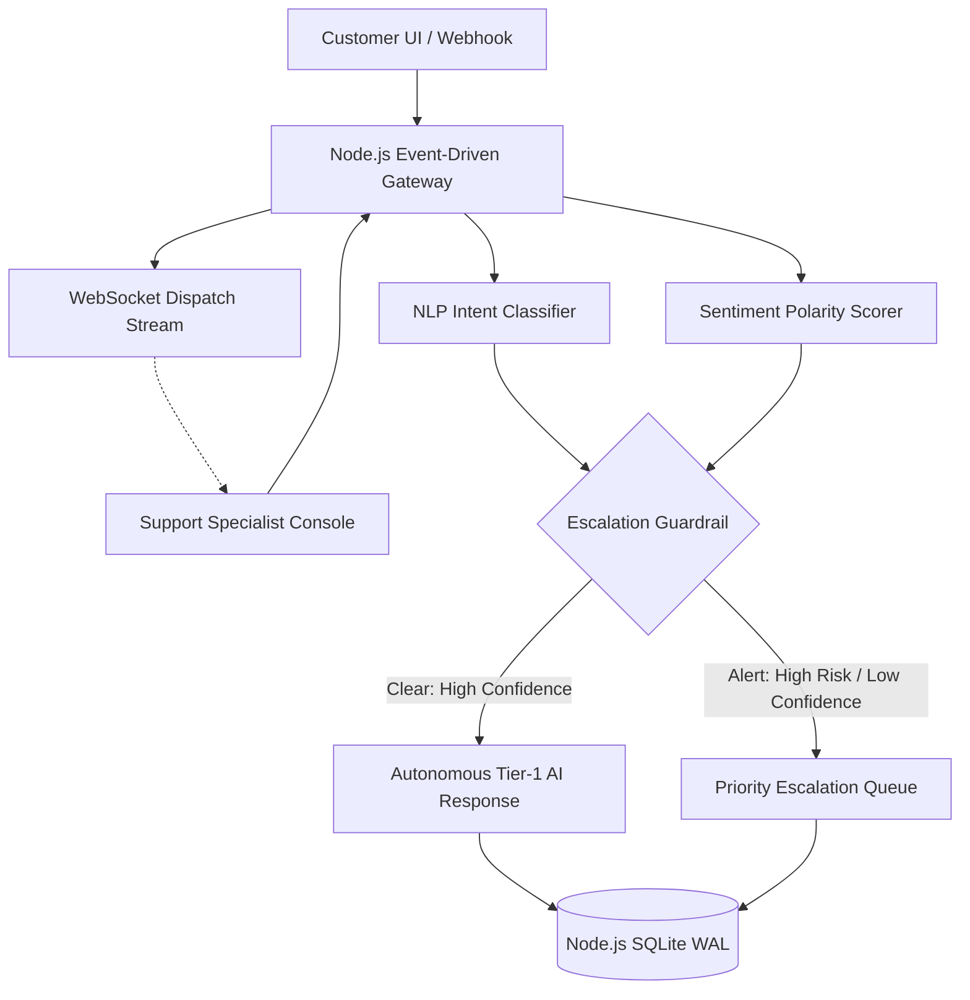

# SupportPilot — AI Support Dispatch & Omnichannel Triage

**Author:** Alvin MS ([@Soulofghost](https://github.com/Soulofghost))  
**Domain:** Artificial Intelligence & Customer Support Engineering  
**Tier:** ⭐ Flagship Portfolio Project  
**Status:** Verified & Production-Ready  

---

## 1. Project Introduction

**SupportPilot** is an intelligent customer support automation and incident triage platform that unifies real-time customer messaging, rule-based natural language intent classification, automated sentiment telemetry, and autonomous human specialist escalation. SupportPilot handles tier-1 customer inquiries instantly while safeguarding enterprise relationships through real-time sentiment guardrails and high-risk trigger interception.

---

## 2. Problem Statement

Modern customer operations teams face significant friction:
- Tier-1 support queues are congested with repetitive billing, password reset, and status inquiries.
- Pure keyword bots lack context and often frustrate unhappy customers by offering irrelevant canned responses.
- Human escalation frequently happens too late—only after customer churn or legal exposure has already occurred.
- Monolithic customer service tools are bloated, expensive, and difficult to customize for localized incident workflows.

---

## 3. Proposed Solution

SupportPilot solves these challenges through a lightweight, event-driven architecture:
- **Autonomous Intent Classification:** Categorizes inquiries into discrete operational domains (`billing`, `technical_issue`, `account_access`, `cancellation`, `feature_request`).
- **Sentiment & Risk Interceptor:** Evaluates emotional polarity and intercepts critical keywords (e.g. legal threats, fraud allegations, chargeback notices), immediately routing them to high-priority human queues.
- **Bi-Directional WebSocket Stream:** Synchronizes state across customer chat windows and the specialist command console in real time without polling.
- **Dynamic Macro Engine:** Equips support engineers with parameter-interpolated templates (`{{name}}`, `{{email}}`) for swift resolution.

---

## 4. Key Features

- **Multi-Intent NLP Classifier:** Fast, local tokenizer and weighted term frequency classifier calculating explicit confidence intervals.
- **Sentiment Polarity Scoring:** Lexicon-driven emotional evaluation ranging from -1.0 (frustrated) to +1.0 (satisfied).
- **Automated Incident Escalation:** Configurable confidence (< 0.60) and sentiment (< -0.35) thresholds that trigger instant agent handoffs.
- **Live Dispatch Command Console:** Three-column operational layout with incident queue filters, threaded conversation stream, and AI telemetry gauges.
- **Built-in ACID Persistence:** Zero external database server requirement utilizing Node.js native SQLite storage in WAL mode.

---

## 5. Architecture Diagram



---

## 6. Technology Stack

- **Runtime:** Node.js v22+
- **Persistence:** Built-in `node:sqlite` (ACID transactions, WAL mode)
- **Real-Time Communication:** WebSockets (`ws` protocol)
- **Natural Language Processing:** Term-frequency weighted intent matching & lexicon sentiment analysis
- **Frontend:** Responsive HTML5, Vanilla JavaScript, CSS Custom Properties (`Space Grotesk` & `JetBrains Mono`)
- **Testing:** Built-in `node:test` and `node:assert`
- **Containerization & CI:** Docker, Docker Compose, GitHub Actions

---

## 7. Folder Structure

```
supportpilot/
├── backend/
│   ├── src/
│   │   ├── config.js          # Port, paths, and guardrail thresholds
│   │   ├── db.js              # SQLite schema, tables, and seed macros
│   │   ├── classifier.js      # NLP intent classifier & sentiment scoring
│   │   ├── ticketService.js   # Ticket lifecycle, messages, and escalation logic
│   │   └── server.js          # HTTP REST router & WebSocket broadcaster
│   ├── tests/
│   │   ├── classifier.test.js # NLP intent & sentiment unit tests
│   │   └── api.test.js        # Ticket lifecycle & macro expansion tests
│   └── package.json           # Project manifest and test runner
├── frontend/
│   ├── index.html             # Command center dashboard layout
│   ├── style.css              # Radar & command center styling
│   └── app.js                 # WebSocket client & DOM controller
├── .github/workflows/ci.yml   # Continuous integration pipeline
├── .env.example               # Config template
├── .gitignore                 # Node & database ignore rules
├── Dockerfile                 # Production image definition
├── docker-compose.yml         # Container composition
├── LICENSE                    # SPDX MIT declaration
└── README.md                  # Comprehensive technical documentation
```

---

## 8. Installation Instructions

### Prerequisites
- Node.js v22.0.0 or higher
- Git

### Setup Steps
```bash
# Clone repository
git clone https://github.com/Soulofghost/supportpilot.git
cd supportpilot

# Install dependencies
cd backend
npm install

# Start development server
node src/server.js
```
Open your browser at `http://localhost:8001`.

---

## 9. Environment Configuration

Copy `.env.example` to `.env`:
```ini
PORT=8001
NODE_ENV=development
DB_PATH=backend/data/supportpilot.db
CONFIDENCE_THRESHOLD=0.60
ESCALATION_SENTIMENT_THRESHOLD=-0.35
```

---

## 10. Database Setup

Database initialization is automatic upon application launch via `getDb()` in `db.js`. It creates tables for `tickets`, `messages`, and `macros` with foreign key cascade support and Write-Ahead Logging (WAL).

---

## 11. API Documentation

| Method | Endpoint | Description |
|---|---|---|
| `GET` | `/api/v1/health` | Service health status and runtime telemetry |
| `GET` | `/api/v1/tickets?status={status}` | Fetch tickets filtered by status (`ALL`, `escalated`, `open`, `closed`) |
| `POST` | `/api/v1/tickets` | Submit customer ticket; triggers classification & AI response |
| `GET` | `/api/v1/tickets/:id` | Fetch full ticket conversation history and metadata |
| `POST` | `/api/v1/tickets/:id/messages` | Append message from customer or specialist |
| `PATCH` | `/api/v1/tickets/:id/status` | Update incident status (`open`, `ai_resolved`, `escalated`, `closed`) |
| `GET` | `/api/v1/macros` | List resolution canned macros |
| `POST` | `/api/v1/classify` | Standalone NLP intent and sentiment analyzer |

---

## 12. UI Walkthrough

The interface provides an aviation dispatch-inspired operational workspace:
1. **Incident Queue (Left):** Real-time ticket list with category chips, status badges, and quick filters.
2. **Conversation Stream (Center):** Message timeline distinguishing between Customer, AI Tier-1, and Human Specialist replies.
3. **AI Telemetry & Macro Console (Right):** Real-time confidence bar, sentiment polarity meter, escalation guardrail alerts, and one-click resolution macros.

---

## 13. Testing Instructions

SupportPilot uses Node's native test runner for fast, zero-dependency test execution:

```bash
cd backend
npm test
```

---

## 14. Security Considerations

- **Strict Input Validation:** Form fields and payload lengths are strictly validated before query execution.
- **Prepared Statements:** All SQLite operations execute via parameterized queries, mitigating SQL injection risks.
- **Local Sentiment Inference:** Customer queries are analyzed locally without transferring sensitive incident text to third-party endpoints.

---

## 15. Deployment Instructions

### Docker Deployment
```bash
docker compose up -d --build
```
Access the application at `http://localhost:8001`.

---

## 16. Known Limitations

- Sentiment lexicon currently supports English customer messages.
- High-volume enterprise installations (>100 concurrent agents) should attach Redis for cross-node WebSocket pub/sub clustering.

---

## 17. Future Roadmap

- [ ] Webhook connectors for Zendesk and Jira Service Management.
- [ ] Email ingestion adapter via IMAP / SMTP.
- [ ] Multilingual translation pipeline.

---

## 18. License

Distributed under the MIT License. See `LICENSE` for details.
